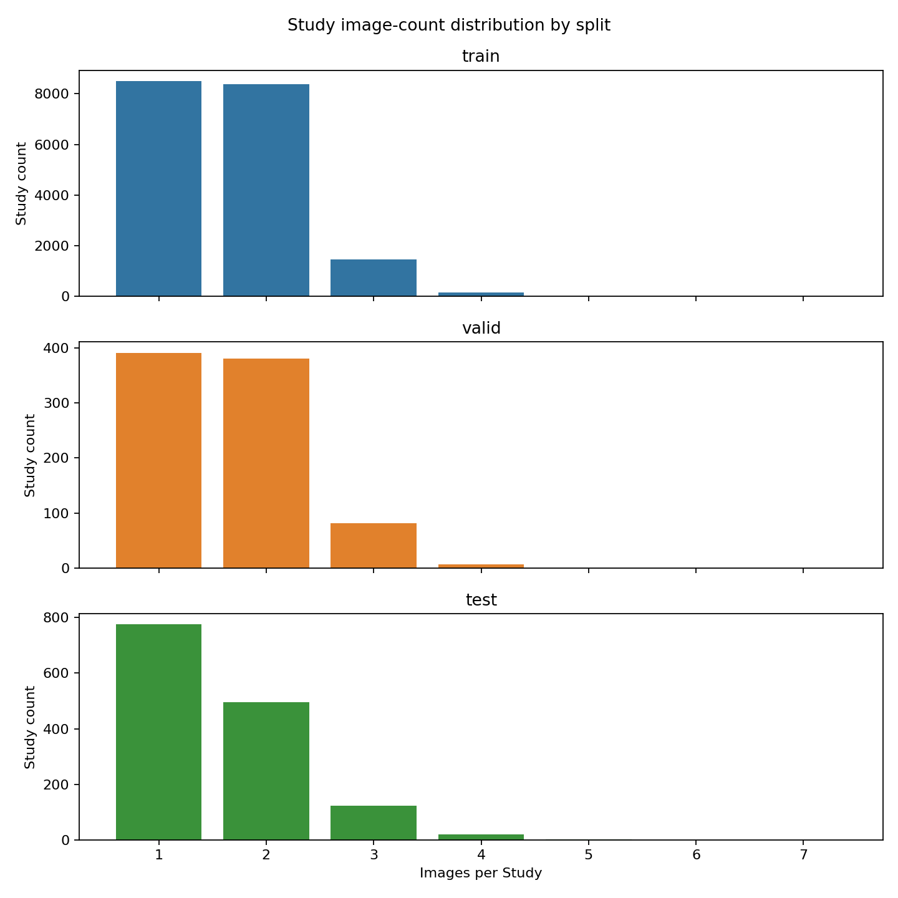

# 数据集结构与完整性审计

## 范围与可复现性

审计脚本：`scripts/audit_cxr.py`。命令：`python scripts/audit_cxr.py --data-root cxr_first --output-root docs`。脚本以只读方式访问源目录，统计产物写入 `docs/`。源 CSV SHA-256、详细文件清单和运行摘要见 `tables/audit_manifest.json`、`tables/source_file_inventory.csv`。本次递归扫描发现 33,987 个源文件：.csv: 3 个 (2,076,943 bytes); .jpg: 33,984 个 (55,451,772,443 bytes)。

| 划分 | Subject 数 | Study 数（Subject_id + Study_id） | Image 行数 | 每 Study 图片均值 | 中位数 | 单图 Study | 双图 Study | ≥3 图 Study | 最大图片数 |
|---|---:|---:|---:|---:|---:|---:|---:|---:|---:|
| train | 11,055 | 18,513 | 30,344 | 1.639 | 2 | 8,507 | 8,369 | 1,637 | 7 |
| valid | 228 | 859 | 1,422 | 1.655 | 2 | 391 | 380 | 88 | 4 |
| test | 136 | 1,414 | 2,218 | 1.569 | 1 | 775 | 496 | 143 | 5 |

`Study_id` 全局唯一（跨 Subject）=True；跨划分 Subject 重叠数=0。以联合键作为统计和校验主键。Subject 每人 Study 数分布详见 `tables/subject_study_counts_*.csv`；Study 图片数明细详见 `tables/study_image_counts_*.csv`。各划分最大图片数及对应检查：

| split | Subject_id | Study_id | image_count |
| --- | --- | --- | --- |
| train | subject_01131 | study_01177 | 7 |
| valid | subject_11896 | study_20135 | 4 |
| valid | subject_11924 | study_20561 | 4 |
| valid | subject_12023 | study_20677 | 4 |
| valid | subject_11978 | study_20682 | 4 |
| valid | subject_11829 | study_20757 | 4 |
| valid | subject_11836 | study_20848 | 4 |
| valid | subject_11915 | study_20930 | 4 |
| test | subject_12089 | study_21101 | 5 |

### Subject 每人 Study 数分布

| split | study_count | subject_count |
| --- | --- | --- |
| test | 1 | 11 |
| test | 2 | 16 |
| test | 3 | 10 |
| test | 4 | 10 |
| test | 5 | 13 |
| test | 6 | 10 |
| test | 7 | 6 |
| test | 8 | 4 |
| test | 9 | 9 |
| test | 10 | 4 |
| test | 11 | 3 |
| test | 12 | 4 |
| test | 13 | 1 |
| test | 14 | 3 |
| test | 15 | 2 |
| test | 16 | 2 |
| test | 17 | 2 |
| test | 18 | 2 |
| test | 19 | 1 |
| test | 20 | 3 |
| test | 21 | 2 |
| test | 22 | 2 |
| test | 23 | 1 |
| test | 24 | 2 |
| test | 26 | 1 |
| test | 27 | 1 |
| test | 28 | 1 |
| test | 29 | 1 |
| test | 30 | 2 |
| test | 32 | 1 |
| test | 34 | 1 |
| test | 39 | 1 |
| test | 40 | 1 |
| test | 48 | 1 |
| test | 52 | 1 |
| test | 62 | 1 |
| train | 1 | 7526 |
| train | 2 | 1861 |
| train | 3 | 785 |
| train | 4 | 371 |
| train | 5 | 209 |
| train | 6 | 106 |
| train | 7 | 75 |
| train | 8 | 40 |
| train | 9 | 29 |
| train | 10 | 14 |
| train | 11 | 17 |
| train | 12 | 8 |
| train | 13 | 5 |
| train | 14 | 2 |
| train | 15 | 2 |
| train | 18 | 4 |
| train | 21 | 1 |
| valid | 1 | 119 |
| valid | 2 | 33 |
| valid | 3 | 21 |
| valid | 4 | 10 |
| valid | 5 | 10 |
| valid | 6 | 4 |
| valid | 7 | 3 |
| valid | 8 | 5 |
| valid | 9 | 3 |
| valid | 10 | 3 |
| valid | 11 | 3 |
| valid | 12 | 1 |
| valid | 13 | 3 |
| valid | 14 | 2 |
| valid | 16 | 1 |
| valid | 17 | 1 |
| valid | 18 | 1 |
| valid | 26 | 2 |
| valid | 36 | 1 |
| valid | 39 | 1 |
| valid | 89 | 1 |

## 图片和完整性

CSV 的 `Dicom_id`、`Subject_id`、`Study_id` 与文件目录层级匹配为 `split/Subject_id/Study_id/Dicom_id.jpg`。CSV 图像引用 33,984 行，缺失引用 0；目录中未被 CSV 引用的 JPEG/PNG 0；重复 Dicom_id 行 0。损坏/无法读取图像 0。文件字节 SHA-256 完全重复组 14 组、涉及 28 张，跨 Study 重复组 0，跨划分重复组 0。本次不做不同编码下的感知重复检测。重复明细、缺图、孤立图和维度不匹配见 `tables/`。

- 可读图像：33,984；格式：{'JPEG': 33984}。
- Pillow 模式分布：

| mode | images |
| --- | --- |
| L | 33984 |

- 宽度（最小/中位/最大）：[1067, 2544.0, 4280]；高度：[1409, 3019.0, 4280]；宽高比范围和中位数：[0.5341246290801187, 0.8324607329842932, 1.6805797101449276]。
- 最常见的实际像素尺寸：

| width | height | size |
| --- | --- | --- |
| 2544 | 3056 | 14252 |
| 3056 | 2544 | 4788 |
| 2539 | 3050 | 1464 |
| 3050 | 2539 | 1370 |
| 1736 | 2022 | 1158 |
| 1760 | 2140 | 1053 |
| 2021 | 2021 | 929 |
| 2022 | 2022 | 605 |
| 2140 | 1760 | 290 |
| 2022 | 1736 | 148 |
| 2520 | 3056 | 60 |
| 2544 | 3052 | 60 |
| 2516 | 3056 | 57 |
| 2524 | 3056 | 54 |
| 2540 | 3056 | 53 |

CSV 的 `Rows` / `Columns` 与图片解码尺寸不一致行数：0。统计像素通道模式，不对灰度图重新编码。完整图像明细见 `tables/image_metadata.csv`。

## Study 图片数和视角组合

分类规则：AP/PA 归正位，LATERAL/LL 归侧位，PA LLD 等未完全映射取值归“其他/复合”，空值保留为缺失。正侧位组合按 Study 计数：

| split | view_combination | study_count |
| --- | --- | --- |
| test | 侧位+正位 | 480 |
| test | 侧位+正位+缺失 | 2 |
| test | 侧位+缺失 | 20 |
| test | 正位 | 842 |
| test | 缺失 | 70 |
| train | 侧位 | 25 |
| train | 侧位+其他/复合+正位 | 1 |
| train | 侧位+正位 | 8382 |
| train | 侧位+正位+缺失 | 1 |
| train | 侧位+缺失 | 179 |
| train | 正位 | 9378 |
| train | 缺失 | 547 |
| valid | 侧位 | 1 |
| valid | 侧位+正位 | 383 |
| valid | 侧位+缺失 | 11 |
| valid | 正位 | 446 |
| valid | 正位+缺失 | 1 |
| valid | 缺失 | 17 |

| 字段 | 训练集空值 | 验证集空值 | 测试集空值 |
|---|---:|---:|---:|
| ViewPosition | 1202 | 39 | 139 |
| PatientOrientation | 3307 | 135 | 369 |

字段分布见 `tables/metadata_value_counts.csv`。`Support Devices` 在三个 CSV 中均不存在。`PatientOrientation` 实际值为 Erect/Recumbent/空值；不能将其解释成正位或侧位。

## 键和标签一致性

训练/验证/测试列分别见 `tables/audit_manifest.json`。标签 CSV 行单位是 Image；统计时按 `(Subject_id, Study_id)` 去重。训练集同 Study 标签矛盾数 0，验证集 0。测试集只有图像元数据，没有 `Predict_class`。 用户已确认训练/验证中未列出的类别为阴性；两划分 CSV 均无空 `Predict_class` 行，故模型配置采用闭世界映射。源目录未附该语义字典，此处语义依据用户提供的项目规则。

