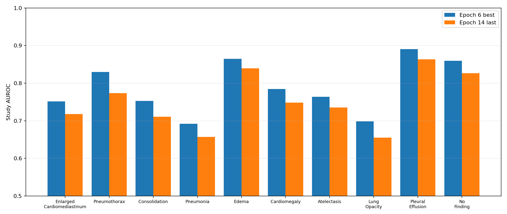

# DenseNet-121 Epoch 6 与 Epoch 14 基线核验

## Checkpoint 与复现口径

| 项目 | Epoch 6 best | Epoch 14 last |
|---|---|---|
| 文件 | `DenseNet121/checkpoint/best/best_by_macro_auc.pth` | `DenseNet121/checkpoint/last/last.pth` |
| SHA-256 | `8162986883188d168b013ad926f70eccddd559f61d9c922b05ab5db9eff7d477` | `93b025feeaa45dbc370d4581acbf14de510840ba8bca42ea8fe70d8635663523` |
| checkpoint 内 epoch | 6 | 14 |
| 模型配置 | DenseNet-121 / GAP / Linear(1024,10) / no CBAM / logit_mean | 同左 |
| 历史 best Macro-AUROC | 0.788827 | 0.788827（last 中记录的全程 best） |

两个 state dict 都以 `strict=True` 加载成功，各含 727 个张量。验证使用 `cxr_first/valid.csv`，859 个 Study、1,422 张图，输入为 320×320；沿用 checkpoint 保存的 BF16 autocast。Epoch 6 fresh Macro-AUROC 为 0.788776，与训练日志 0.788827 相差 0.000051；Epoch 14 fresh 为 0.752761，与日志 0.752753 相差 0.000008。Fresh Epoch 6 的 Study 概率与训练期 `val_best.csv` 最大绝对差为 0.001634，属于 BF16 Study 聚合路径的数值差异；指标和排序基本复现。

checkpoint 内的训练配置才是本次历史实验依据：BCE、image budget 16、gradient accumulation 2、backbone/head LR `2e-5/2e-4`、AdamW、weight decay `1e-4`、warmup 2、patience 8、AMP BF16、seed 42。当前 `configs/train.yaml` 已变为 image budget 32 / accumulation 1；它与历史 checkpoint 配置不同，不能用来描述旧模型。

验证预处理为 ResizePad(320) → 灰度转三通道 → ImageNet mean/std 归一化。测试集没有参与本次评估。官方 73.15 是单独的官方成绩；这里没有把它换算成本地 AUROC。

## 逐类结果

| 类别 | Epoch 6 AUROC | Epoch 14 AUROC | 差值 | Epoch 6 AUPRC | Epoch 14 AUPRC |
|---|---:|---:|---:|---:|---:|
| Enlarged Cardiomediastinum | 0.7512 | 0.7178 | -0.0335 | 0.0848 | 0.0705 |
| Pneumothorax | 0.8299 | 0.7735 | -0.0565 | 0.2772 | 0.2263 |
| Consolidation | 0.7531 | 0.7109 | -0.0421 | 0.1923 | 0.1390 |
| Pneumonia | 0.6921 | 0.6570 | -0.0351 | 0.1775 | 0.1690 |
| Edema | 0.8646 | 0.8394 | -0.0252 | 0.4335 | 0.3797 |
| Cardiomegaly | 0.7845 | 0.7481 | -0.0364 | 0.4353 | 0.4007 |
| Atelectasis | 0.7636 | 0.7355 | -0.0281 | 0.4408 | 0.4110 |
| Lung Opacity | 0.6986 | 0.6553 | -0.0433 | 0.4041 | 0.3766 |
| Pleural Effusion | 0.8909 | 0.8636 | -0.0272 | 0.7846 | 0.7465 |
| No Finding | 0.8593 | 0.8265 | -0.0328 | 0.7972 | 0.7371 |
| **Macro-AUROC** | **0.7888** | **0.7528** | **-0.0360** | — | — |

十类 AUROC 全部下降。相对降幅最大的类别为 Pneumothorax（-0.0565）、Lung Opacity（-0.0433）和 Consolidation（-0.0421）；肺炎在 Epoch 6 已较弱，Epoch 14 又下降 0.0351。强类 Pleural Effusion、Edema、No Finding 也分别下降 0.0272、0.0252、0.0328，没有出现“弱类改善而强类稳定”的结果。

## 训练变化与停止点

| Epoch | Train loss | Validation loss | Macro-AUROC | Macro-F1@0.5 | 平均 gradient norm |
|---:|---:|---:|---:|---:|---:|
| 6 | 0.29181 | 0.33012 | 0.78883 | 0.27087 | 2.2156 |
| 14 | 0.19493 | 0.41559 | 0.75275 | 0.31411 | 4.4189 |

训练 loss 持续降低，但验证 loss 上升、Macro-AUROC 下降且 gradient norm 增大。这与后期泛化退化/过拟合相符；单凭这些日志不能证明具体的特征退化机制。Epoch 6 后连续 8 轮未刷新 best，patience=8 在 Epoch 14 正好触发停止；停止条件合理，但回看验证轨迹，较短 patience 可能节省后期训练成本。

Enlarged Cardiomediastinum 在验证集仅有 24 个阳性 Study。400 次 Subject-cluster bootstrap 的 AUROC 95% 区间为 0.612–0.853，说明逐类估计不确定性较大，不能把小幅逐类变化解读为稳定规律。

本次 GPU 为 RTX 4060 Laptop 8 GB，未在 NVIDIA T4 上测量延迟。模型文件大小约 28.5 MB；T4 的 100 ms 约束仍需在目标环境和官方计时口径下单独验证。
