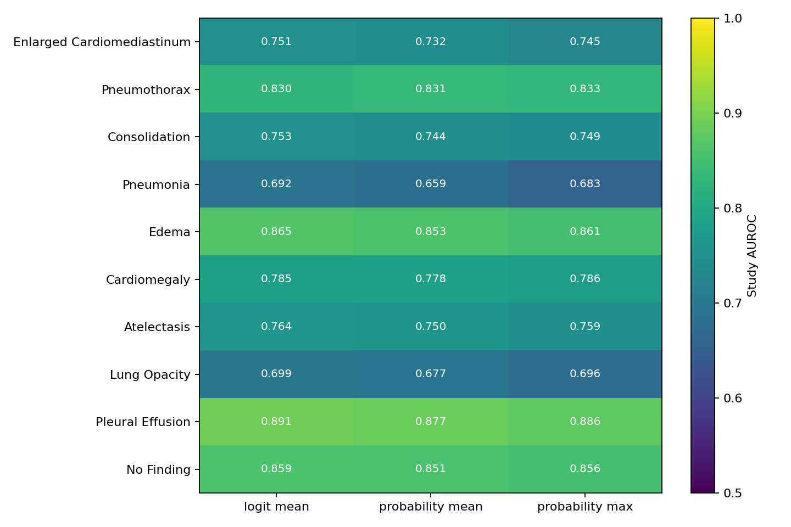

# DenseNet-121 Study 融合对照

## 实验设计

固定 Epoch 6 best checkpoint 和验证集 859 个 Study；用同一份 BF16 逐图 raw-logit cache 离线计算三种融合，不重新训练、不重新跑 backbone：

- `logit_mean`：Study 内平均逐图 logits，再做 sigmoid。
- `probability_mean`：逐图 sigmoid 后按类平均概率。
- `probability_max`：逐图 sigmoid 后按类取最大概率。

逐图 logits、Study 概率、逐类指标和配置记录在 `DenseNet121/outputs/experiments/densenet_epoch6_diagnostics/`。三种方法对单图 Study 数值相同。

## 总体结果

| 融合 | Macro-AUROC | Δ vs logit_mean | Macro-F1@0.5 |
|---|---:|---:|---:|
| Logit Mean | **0.7888** | — | 0.2709 |
| Probability Mean | 0.7855 | -0.0032 | 0.2710 |
| Probability Max | 0.7751 | -0.0137 | 0.2879 |

按 Subject 重采样 400 次，Macro-AUROC 差值的 95% bootstrap 区间：Probability Mean 相对 Logit Mean 为 `[-0.0067, -0.0005]`；Probability Max 为 `[-0.0210, -0.0079]`。这支持当前验证集上 Logit Mean 排序较好，但区间是单一验证划分的 Subject-bootstrap 估计，不是外部泛化保证。

## 逐类指标

### AUROC

| 类别 | Logit Mean | Probability Mean | Probability Max |
|---|---:|---:|---:|
| Enlarged Cardiomediastinum | 0.7512 | 0.7449 | 0.7317 |
| Pneumothorax | 0.8299 | **0.8333** | 0.8314 |
| Consolidation | **0.7531** | 0.7489 | 0.7437 |
| Pneumonia | **0.6921** | 0.6831 | 0.6593 |
| Edema | **0.8646** | 0.8610 | 0.8527 |
| Cardiomegaly | 0.7845 | **0.7862** | 0.7780 |
| Atelectasis | **0.7636** | 0.7594 | 0.7495 |
| Lung Opacity | **0.6986** | 0.6962 | 0.6770 |
| Pleural Effusion | **0.8909** | 0.8860 | 0.8767 |
| No Finding | **0.8593** | 0.8564 | 0.8511 |

### AUPRC

| 类别 | Logit Mean | Probability Mean | Probability Max |
|---|---:|---:|---:|
| Enlarged Cardiomediastinum | 0.0848 | 0.0833 | 0.0726 |
| Pneumothorax | 0.2772 | **0.2980** | 0.2978 |
| Consolidation | 0.1923 | **0.1928** | 0.1826 |
| Pneumonia | **0.1775** | 0.1731 | 0.1503 |
| Edema | **0.4335** | 0.4317 | 0.4162 |
| Cardiomegaly | 0.4353 | 0.4392 | **0.4401** |
| Atelectasis | **0.4408** | 0.4378 | 0.4300 |
| Lung Opacity | **0.4041** | 0.4024 | 0.3845 |
| Pleural Effusion | **0.7846** | 0.7800 | 0.7659 |
| No Finding | **0.7972** | 0.7839 | 0.7857 |

Probability Mean 在 Pneumothorax 的 AUROC/AUPRC 略高，Cardiomegaly AUROC 也略高；但这些局部优势没有抵消 Macro-AUROC 下滑。Pneumonia、Lung Opacity、Consolidation 均以 Logit Mean 较好。没有足够证据支持类别级混合搜索。

## Study 图片数分组

| 图片数 | Study 数 | Logit Mean Macro-AUROC | Probability Mean | Probability Max |
|---:|---:|---:|---:|---:|
| 1 | 391 | 0.7106 | 0.7106 | 0.7106 |
| 2 | 380 | 0.8384 | 0.8352 | 0.8276 |
| 3 | 81 | 0.7914 | 0.7859 | 0.7754 |
| 4 | 7 | 0.8000 | 0.8194 | 0.8444 |
| 2 张及以上合并 | 468 | **0.8345** | 0.8306 | 0.8214 |

单图组的三种融合自然相同。4 图 Study 只有 7 个，结果不稳定；多图合并组上 Logit Mean 最高。不同图片数组也可能具有不同病例构成，组间差异不能单独证明融合带来的因果提升。

视角分组中 AP-only 有 442 Study、Macro-AUROC 0.7073；混合视角有 383 Study、0.8511。PA-only 只有 5 Study、LL-only 11 Study、unknown 17 Study；视角组成明显不平衡，不能据此断言模型存在视角偏差。

## Probability Max 的误报代价

在固定 0.5 阈值下，Probability Max 对多个类别增加假阳性 Study 数：Lung Opacity 从 27 增至 51，Atelectasis 从 39 增至 58，Cardiomegaly 从 45 增至 64，Pleural Effusion 从 48 增至 63，No Finding 从 83 增至 105；其 Macro-F1 虽略高，Macro-AUROC 却低 0.0137。AUROC 是本竞赛主指标，不能因为阈值 F1 提高而选 Max。

**下一轮建议保留 Logit Mean。** Probability Mean 可作为低优先级敏感性对照；Probability Max 在当前数据上没有整体排序收益，且出现更多固定阈值假阳性。
