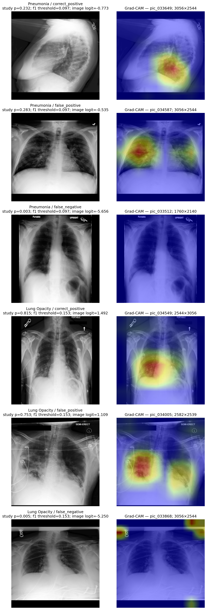

# DenseNet-121 弱类错误与可视化分析

## Epoch 6 弱类概况

模型为已核验的 Epoch 6 best，验证集所有指标均按 Study 计算，输出遵循 checkpoint 的 BF16 精度。

| 类别 | 验证阳性 Study | AUROC | AUPRC | F1@0.5 | F1 最优验证阈值* | 该阈值下 F1* |
|---|---:|---:|---:|---:|---:|---:|
| Enlarged Cardiomediastinum | 24 | 0.7512 | 0.0848 | 0.0000 | 0.0995 | 0.1778 |
| Pneumothorax | 37 | 0.8299 | 0.2772 | 0.0000 | 0.0981 | 0.3898 |
| Consolidation | 46 | 0.7531 | 0.1923 | 0.0000 | 0.1052 | 0.2333 |
| Pneumonia | 68 | 0.6921 | 0.1775 | 0.0000 | 0.0967 | 0.2751 |
| Lung Opacity | 214 | 0.6986 | 0.4041 | 0.1880 | 0.1530 | 0.4829 |

\* F1 最优阈值是在同一验证集上搜索，只用来检查分数分布和挑选可视化样本，不能视为独立阈值评估或官方阈值。

Epoch 6 的 Pneumonia 和 Lung Opacity 已是相对弱类；第 14 轮还分别降到 0.6570 和 0.6553。Consolidation 从 0.7531 降至 0.7109。Pneumonia 的阳性 Study 中位概率约 0.099、阴性中位约 0.053，二者分布重叠；0.5 阈值下没有阳性预测，所以 F1=0 不能说明 AUROC 计算错误。Lung Opacity 的阳性中位概率约 0.318、阴性中位约 0.193，分布仍有明显重叠；其 AUPRC 0.404 高于验证阳性率 0.249，但 AUROC 仅 0.699，说明排序仍有较多正负交错。

Enlarged Cardiomediastinum 的 AUROC bootstrap 95% 区间为 0.612–0.853（400 次 Subject-cluster bootstrap）；24 个阳性 Study 造成较大不确定性。不要把它与样本更多类别的小幅差值等同解读。

## 图片数、视角与分辨率

| 分组 | Study 数 | Pneumonia AUROC | Lung Opacity AUROC | Consolidation AUROC |
|---|---:|---:|---:|---:|
| 单图 | 391 | 0.6248 | 0.6334 | 0.6918 |
| 2 图 | 380 | 0.7356 | 0.7017 | 0.8317 |
| 3 图 | 81 | 0.9402 | 0.6687 | 0.5506 |

三图组的 Pneumonia AUROC 较高，但只有 81 个 Study，且各组阳性数不同；Consolidation 在三图组反而仅 0.551。不能据此确定多视图对某类有因果增益。验证图像原始尺寸主要集中在 3056×2544（558 张）、2544×3056（163 张）、2539×3050（81 张）和 3050×2539（76 张）；模型统一缩放/填充到 320×320，细节损失仍是分辨率实验的候选因素，但还不能认定是当前弱类主因。

AP-only Study 有 442 个，Pneumonia AUROC 0.589、Lung Opacity 0.632；mixed-view 有 383 个，分别为 0.783 和 0.734。PA-only 仅 5 个、LL-only 11 个、view unknown 17 个。视角分组病例构成差异大、极小组指标不稳定，当前证据不能确认视角造成类别退化。

## 代表性高分负例与低分正例

下表分数使用 Logit Mean。每类阈值是验证集最大 F1 阈值，因此 `FP/FN` 标签只对应该诊断阈值；0.5 阈值下 Pneumonia、Consolidation、Enlarged Cardiomediastinum 均没有真阳性预测。

| 类别 | 代表类型 | Study | 概率 | 诊断阈值 | 图数 / 视角 | 中位短边 | 共现阳性标签 |
|---|---|---|---:|---:|---|---:|---|
| Pneumonia | 高分负例 / FP | `subject_11829 / study_20922` | 0.2834 | 0.0967 | 2 / LATERAL; PA | 2544 | Lung Opacity |
| Pneumonia | 低分正例 / FN | `subject_11915 / study_20273` | 0.0035 | 0.0967 | 1 / 未记录 | 1760 | Lung Opacity |
| Lung Opacity | 高分负例 / FP | `subject_11827 / study_20575` | 0.7535 | 0.1530 | 1 / AP | 2539 | No Finding |
| Lung Opacity | 低分正例 / FN | `subject_11948 / study_20490` | 0.0052 | 0.1530 | 1 / AP | 2544 | 无 |
| Consolidation | 高分负例 / FP | `subject_11829 / study_20399` | 0.2759 | 0.1052 | 1 / 未记录 | 1760 | Edema; Pleural Effusion |
| Consolidation | 低分正例 / FN | `subject_11855 / study_20254` | 0.0023 | 0.1052 | 1 / AP | 2544 | Atelectasis |
| Pneumothorax | 高分负例 / FP | `subject_11903 / study_20526` | 0.5908 | 0.0981 | 1 / AP | 2539 | Pneumonia; Lung Opacity |
| Pneumothorax | 低分正例 / FN | `subject_11855 / study_20400` | 0.0004 | 0.0981 | 2 / AP | 2544 | 无 |

对照标签共现：68 个 Pneumonia 阳性中，10 个同时有 Consolidation（14.7%）、11 个有 Atelectasis（16.2%）、23 个有 Pleural Effusion（33.8%）。791 个 Pneumonia 阴性中相应比例为 4.6%、23.0%、30.0%。214 个 Lung Opacity 阳性中，Consolidation 共现率为 5.1%，与阴性组 5.4% 接近；Atelectasis/effusion 共现率分别为 25.7%/32.7%，阴性组为 21.4%/29.5%。这些统计没有显示 Lung Opacity 弱项可简单归因于与 Consolidation 的标签混淆；共现不等于影像混淆。

## Grad-CAM

样本按验证集最大 F1 阈值各选取正确阳性、高分负例和低分正例；每个 Study 显示最支持该类别的单张图。若干真阳性热区覆盖肺野/肺底；Pneumonia 高分负例也在双侧肺野出现响应。Pneumonia 低分正例与 Lung Opacity 低分正例的热区主要落在图像边缘/标记区域，未明显覆盖肺野。这提示边缘文字或设备信息可能参与了个别错误，但 Grad-CAM 只是模型响应图，不是病灶标注；单个样本不能据此断言模型依赖伪特征或确认具体疾病混淆。

当前证据支持先检查低分正例、标签噪声、分辨率预处理和模型对边缘标记的敏感性。它尚不足以证明需要加 CBAM、Label Cross-Attention 或多尺度头；结构变化应等配对 loss 实验结束后只选择一项再验证。
