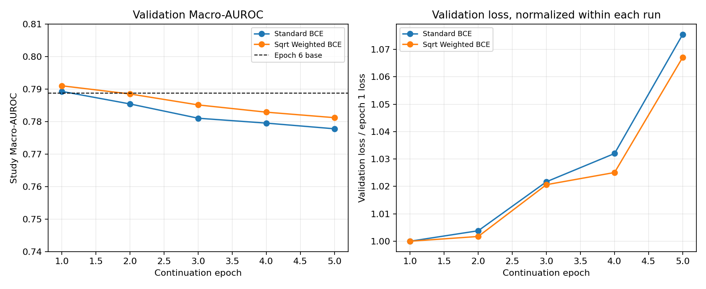

# DenseNet-121 Standard BCE 与 Sqrt Weighted BCE 对照

## 配对设计与复现信息

两组都从 Epoch 6 best 权重开始，使用 `--init-checkpoint` 严格加载模型 state dict，并重新创建 AdamW、scheduler 与 scaler；两组初始化 checkpoint SHA 均为：

`8162986883188d168b013ad926f70eccddd559f61d9c922b05ab5db9eff7d477`

| 控制项 | 两组共同设置 |
|---|---|
| Backbone / head / fusion | DenseNet-121 / GAP / Logit Mean |
| 分辨率 / 增强 | 320×320；同一训练增强和验证预处理 |
| Seed / Study 划分 | 42 / 同一 train 与 valid |
| Batch | image budget 16，gradient accumulation 2 |
| Optimizer | 新建 AdamW，weight decay 1e-4 |
| Backbone / head LR | 5e-6 / 5e-5 |
| Scheduler | 2 epoch warmup 后 cosine |
| 预算 | 最多 8 epoch，patience 4；两组均 5 epoch 后 early stop |
| AMP | BF16 |

采用低学习率是基于阶段 A 的后期退化证据：原训练 epoch 6→14 train loss 降、validation loss 升且 Macro-AUROC 明显降。低学习率和预算在两组完全一致，因此两组之间的主要变量仍是 loss。两份配置只有 `loss` 和独立 `output_dir` 不同；Weighted BCE 权重从训练 Study 标签重新计算，没有用手工值或验证集估权。

Standard BCE：best continuation epoch 1，训练 5 epoch；checkpoint SHA `097c8047620ed9b9d2f87d30b446d3276bb51b3b4e5a84eca64dd9a90cd5f6dc`，28,463,825 bytes。Sqrt Weighted BCE：best continuation epoch 1，训练 5 epoch；checkpoint SHA `60b9816d65b12fd09f26e5c1771c27d546c0f29d9cc1090c4834dfaf8072c1e9`，28,464,081 bytes。两组峰值 GPU 分配记录均为 2.184 GB；训练时间约 6,200–6,251 秒，验证累计约 338–343 秒。checkpoint 远低于 500 MB，但 T4 延迟未在当前 RTX 4060 上代测。

源码版本记录：Git HEAD `e5f3ea23250d21c13ecaf85815cd504e136483f9`；训练入口 SHA-256 `833228e9de0ee3d9012c668ca0b63e909fea6d99403f7278124572adcc026991`。完整配置、每轮日志、checkpoint 和 `val_best.csv` 分别在 `DenseNet121/outputs/experiments/paired_standard_bce/` 与 `paired_sqrt_weighted_bce/`。

配置 SHA-256：Standard BCE `40dff7fcf6a5a0d014a4e145390ae04ac4ce128fd43458a51d411b7fc7be1ad5`；Sqrt Weighted BCE `e51ac39748994ef8e389c50bd54bbe2dad4fd8d547275b4352e306ef2824950d`。

## 总体结果

| 模型 | Best continuation epoch | Best Macro-AUROC | Macro-F1@0.5 | 相对 Epoch 6 fresh 验证 |
|---|---:|---:|---:|---:|
| Epoch 6 base | — | 0.78878 | 0.27087 | — |
| Standard BCE | 1 | 0.78927 | 0.27551 | +0.00049 |
| Sqrt Weighted BCE | 1 | 0.79098 | 0.39521 | +0.00221 |

Weighted BCE 的点估计高于 Standard BCE 0.00171，但 2,000 次 paired Subject-cluster bootstrap 的 Macro-AUROC 差值 95% 区间为 `[-0.00124, 0.00442]`，包含 0。Weighted BCE 相对 Epoch 6 base 的区间为 `[-0.00095, 0.00508]`，也包含 0。单一 seed、单一验证划分下，没有充分证据称 Weighted BCE 稳定改善 Macro-AUROC；点差值仍可能是验证采样波动。

两组 validation Macro-AUROC 都在 continuation epoch 1 最高，后续逐轮下降并在 4 个 stale epoch 后停止。各自的 train loss 在下降、validation loss 在上升；两组的 loss 数值尺度不同，不能直接横向比较 train/val loss 大小。

## 逐类结果

| 类别 | Epoch 6 AUROC | Standard BCE AUROC | Weighted BCE AUROC | Weighted−BCE | BCE AUPRC | Weighted AUPRC | F1@0.5 BCE / Weighted |
|---|---:|---:|---:|---:|---:|---:|---:|
| Enlarged Cardiomediastinum | 0.7512 | 0.7500 | 0.7569 | +0.0069 | 0.0841 | 0.0908 | 0.000 / 0.000 |
| Pneumothorax | 0.8299 | 0.8317 | 0.8408 | +0.0091 | 0.2811 | 0.2922 | 0.051 / 0.329 |
| Consolidation | 0.7531 | 0.7534 | 0.7553 | +0.0019 | 0.1935 | 0.2029 | 0.000 / 0.190 |
| Pneumonia | 0.6921 | 0.6927 | 0.6902 | -0.0025 | 0.1812 | 0.1840 | 0.000 / 0.122 |
| Edema | 0.8646 | 0.8646 | 0.8638 | -0.0008 | 0.4324 | 0.4293 | 0.408 / 0.509 |
| Cardiomegaly | 0.7845 | 0.7862 | 0.7869 | +0.0007 | 0.4395 | 0.4402 | 0.322 / 0.459 |
| Atelectasis | 0.7636 | 0.7635 | 0.7641 | +0.0006 | 0.4428 | 0.4412 | 0.338 / 0.467 |
| Lung Opacity | 0.6986 | 0.7002 | 0.7011 | +0.0010 | 0.4048 | 0.4063 | 0.201 / 0.420 |
| Pleural Effusion | 0.8909 | 0.8911 | 0.8912 | +0.0001 | 0.7847 | 0.7850 | 0.718 / 0.720 |
| No Finding | 0.8593 | 0.8593 | 0.8594 | +0.0002 | 0.7964 | 0.7961 | 0.718 / 0.735 |

Weighted BCE 对 Enlarged Cardiomediastinum、Pneumothorax 和 Consolidation 的 AUROC 有小幅提升，但 Pneumonia 略降，Lung Opacity 仅升 0.0010。Edema 与 Pleural Effusion 基本稳定。固定 0.5 阈值下多个类别 F1 上升，但同时假阳性增加：Pneumothorax 1→29、Edema 53→93、Cardiomegaly 52→115、Atelectasis 53→125、Lung Opacity 28→102、Pleural Effusion 74→103。竞赛主指标是 AUROC，不能把阈值 F1 的提升解释为排序能力改善。

单图 Study Macro-AUROC：Standard 0.7113、Weighted 0.7123；多图 Study：Standard 0.8353、Weighted 0.8373。组间病例构成不同，Weighted 的多图差值只有 0.0020，不能作为独立总体收益证据。

## 结论

本轮 matched pair 没有证实 Sqrt Weighted BCE 能稳定提升 Macro-AUROC。它让低频类别在固定阈值下输出更多阳性、改善部分 F1，但对应更多假阳性；Pneumonia AUROC 没有改善，Lung Opacity 变化极小。Macro-AUROC 的 bootstrap 区间跨 0，因此不据此替换当前 Standard BCE 基线。ASL 未在本轮测试。
