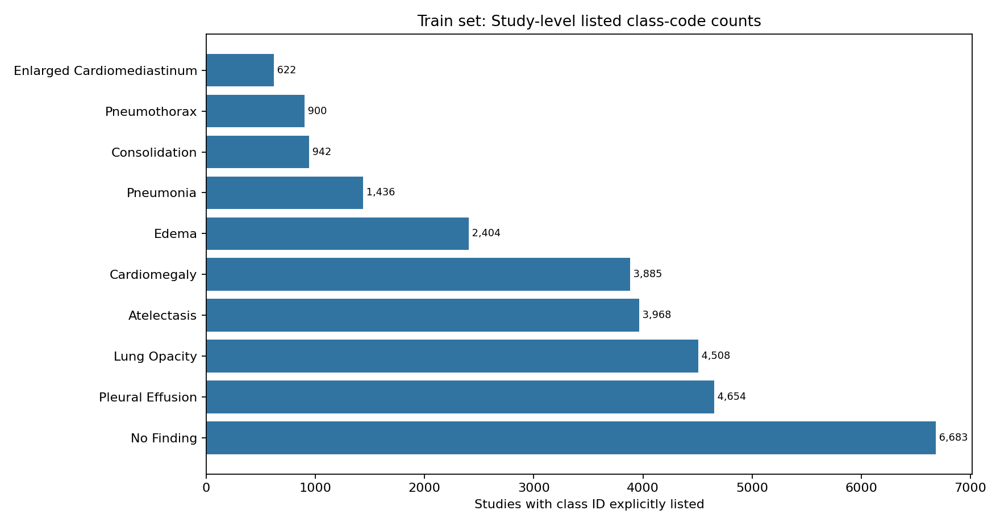
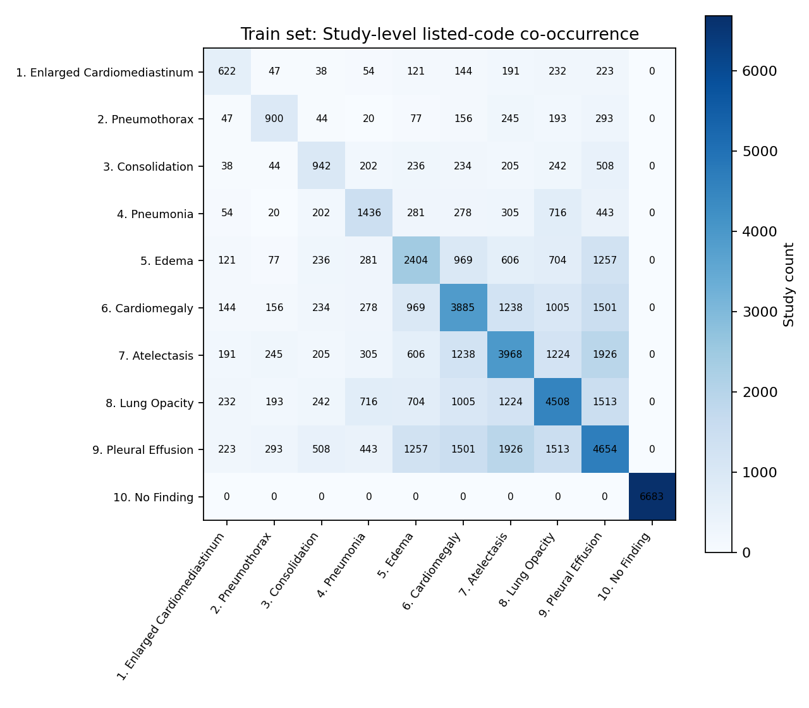

# Study 级标签分布

## 标签语义与统计口径

`Predict_class` 是分号分隔的阳性类别 ID。用户已确认：训练集和验证集中未列出的类别为阴性。源目录本身没有标签字典说明该语义，因此这是项目提供的标签规则，而非从图像推断。复核 CSV 后，训练集 30,344 行、验证集 1,422 行均无空 `Predict_class`；同一 Study 多图标签一致。测试集不含标签列，完全不用于类别比例或权重估计。

以下统计按 `(Subject_id, Study_id)` 去重。对训练/验证的每个 Study，阳性数来自显式列出的 ID，阴性数为 Study 总数减去阳性数；本数据没有空标签行或未知编码，故 `N_unknown=0`、`N_valid=Study总数`。此编码已由两个路线的 `configs/data.yaml` 启用。

## Study 级正负样本数量

每个 Study 只计一次；训练权重只用 train 行。下表及机器可读文件 `tables/label_distribution_study_level.csv` 均按已确认的闭世界规则计算。

| 划分 | ID | 类别 | Study总数 | N_pos | N_neg | N_unknown | N_valid | 阳性比例 | 阴性比例 | N_neg/N_pos |
|---|---:|---|---:|---:|---:|---:|---:|---:|---:|---:|
| train | 1 | Enlarged Cardiomediastinum | 18,513 | 622 | 17,891 | 0 | 18,513 | 0.0336 | 0.9664 | 28.7637 |
| train | 2 | Pneumothorax | 18,513 | 900 | 17,613 | 0 | 18,513 | 0.0486 | 0.9514 | 19.5700 |
| train | 3 | Consolidation | 18,513 | 942 | 17,571 | 0 | 18,513 | 0.0509 | 0.9491 | 18.6529 |
| train | 4 | Pneumonia | 18,513 | 1,436 | 17,077 | 0 | 18,513 | 0.0776 | 0.9224 | 11.8921 |
| train | 5 | Edema | 18,513 | 2,404 | 16,109 | 0 | 18,513 | 0.1299 | 0.8701 | 6.7009 |
| train | 6 | Cardiomegaly | 18,513 | 3,885 | 14,628 | 0 | 18,513 | 0.2099 | 0.7901 | 3.7653 |
| train | 7 | Atelectasis | 18,513 | 3,968 | 14,545 | 0 | 18,513 | 0.2143 | 0.7857 | 3.6656 |
| train | 8 | Lung Opacity | 18,513 | 4,508 | 14,005 | 0 | 18,513 | 0.2435 | 0.7565 | 3.1067 |
| train | 9 | Pleural Effusion | 18,513 | 4,654 | 13,859 | 0 | 18,513 | 0.2514 | 0.7486 | 2.9779 |
| train | 10 | No Finding | 18,513 | 6,683 | 11,830 | 0 | 18,513 | 0.3610 | 0.6390 | 1.7702 |
| valid | 1 | Enlarged Cardiomediastinum | 859 | 24 | 835 | 0 | 859 | 0.0279 | 0.9721 | 34.7917 |
| valid | 2 | Pneumothorax | 859 | 37 | 822 | 0 | 859 | 0.0431 | 0.9569 | 22.2162 |
| valid | 3 | Consolidation | 859 | 46 | 813 | 0 | 859 | 0.0536 | 0.9464 | 17.6739 |
| valid | 4 | Pneumonia | 859 | 68 | 791 | 0 | 859 | 0.0792 | 0.9208 | 11.6324 |
| valid | 5 | Edema | 859 | 115 | 744 | 0 | 859 | 0.1339 | 0.8661 | 6.4696 |
| valid | 6 | Cardiomegaly | 859 | 177 | 682 | 0 | 859 | 0.2061 | 0.7939 | 3.8531 |
| valid | 7 | Atelectasis | 859 | 193 | 666 | 0 | 859 | 0.2247 | 0.7753 | 3.4508 |
| valid | 8 | Lung Opacity | 859 | 214 | 645 | 0 | 859 | 0.2491 | 0.7509 | 3.0140 |
| valid | 9 | Pleural Effusion | 859 | 260 | 599 | 0 | 859 | 0.3027 | 0.6973 | 2.3038 |
| valid | 10 | No Finding | 859 | 306 | 553 | 0 | 859 | 0.3562 | 0.6438 | 1.8072 |

### 类别代码在 Study 中的比例（只描述明确列出的代码）

| class_id | category | train_listed_studies | train_listed_code_share | valid_listed_studies | valid_listed_code_share | valid_minus_train_listed_code_share |
| --- | --- | --- | --- | --- | --- | --- |
| 1 | Enlarged Cardiomediastinum | 622 | 0.0336 | 24 | 0.0279 | -0.0057 |
| 2 | Pneumothorax | 900 | 0.0486 | 37 | 0.0431 | -0.0055 |
| 3 | Consolidation | 942 | 0.0509 | 46 | 0.0536 | 0.0027 |
| 4 | Pneumonia | 1436 | 0.0776 | 68 | 0.0792 | 0.0016 |
| 5 | Edema | 2404 | 0.1299 | 115 | 0.1339 | 0.0040 |
| 6 | Cardiomegaly | 3885 | 0.2099 | 177 | 0.2061 | -0.0038 |
| 7 | Atelectasis | 3968 | 0.2143 | 193 | 0.2247 | 0.0103 |
| 8 | Lung Opacity | 4508 | 0.2435 | 214 | 0.2491 | 0.0056 |
| 9 | Pleural Effusion | 4654 | 0.2514 | 260 | 0.3027 | 0.0513 |
| 10 | No Finding | 6683 | 0.3610 | 306 | 0.3562 | -0.0048 |

训练集阳性 Study 数及按已确认语义计算的阳性比例如下：

训练和验证的 10 类都至少有显式阳性代码：训练每类 622–6,683 个 Study，验证每类 24–306 个 Study；没有零阳性代码类。验证最少类别只有 24 个阳性代码 Study，未来逐类 AUC 仍需正负样本都可识别后谨慎解释。训练集相对长尾的前三类为 Enlarged Cardiomediastinum（622）、Pneumothorax（900）、Consolidation（942）。训练集阳性比例范围为 3.36%–36.10%；对应阴性比例为 63.90%–96.64%。这些比例按 Study 计算。

## 标签共现、阳性数及 No Finding

每个 Study 的类别代码数分布：`tables/study_positive_label_count_distribution.csv`。类别共现 Study 数及 `P(j 被列出 | i 被列出)` 见 `tables/label_cooccurrence.csv` 与 `tables/label_conditional_cooccurrence.csv`。以下热图为训练集 Study 去重后的代码共现数量：

No Finding (ID 10) 与任一 ID 1–9 的显式共现、单独出现数在 `tables/no_finding_relationship.csv`。如果 No Finding 与其他病种代码同时出现，那是数据编码事实，但它是否属于矛盾还取决于官方定义；本报告不据此清洗标签。

## 训练/验证差异和可评测性

训练/验证集的阳性、阴性和比例见上表；共现明细有 split 字段，可计算任意类别条件率差异。验证集十类都同时包含阳性和阴性，因此 AUROC 在标签条件上可计算；实际 AUROC/AUPRC/Macro-F1 仍须模型预测后计算。

| 类别 | 极稀有标记（显式阳性编码 Study < 100） |
|---|---|
| Enlarged Cardiomediastinum | 否（训练=622，验证=24） |
| Pneumothorax | 否（训练=900，验证=37） |
| Consolidation | 否（训练=942，验证=46） |
| Pneumonia | 否（训练=1,436，验证=68） |
| Edema | 否（训练=2,404，验证=115） |
| Cardiomegaly | 否（训练=3,885，验证=177） |
| Atelectasis | 否（训练=3,968，验证=193） |
| Lung Opacity | 否（训练=4,508，验证=214） |
| Pleural Effusion | 否（训练=4,654，验证=260） |
| No Finding | 否（训练=6,683，验证=306） |

